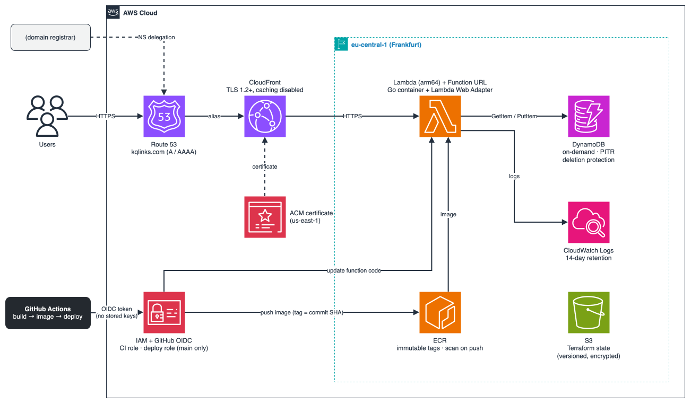
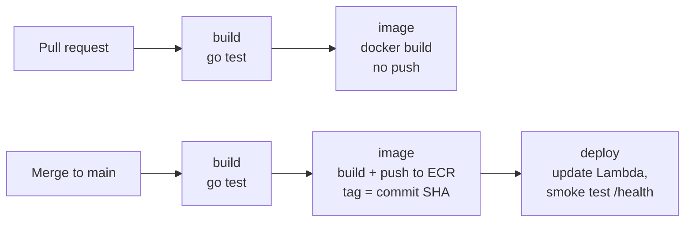

# kqlinks — a serverless URL shortener on AWS

[](https://github.com/Khalid-iq/go-url-shortener-aws/actions/workflows/go.yml)


**Live: [https://kqlinks.com](https://kqlinks.com)**

A URL shortener written in Go and deployed to AWS as a container on Lambda, with DynamoDB storage, a custom domain over HTTPS through CloudFront, and a GitHub Actions pipeline that tests, builds, and deploys every merge to `main`, authenticating to AWS through OIDC with no stored credentials.

The app itself is deliberately small. The point of the project is everything around it: infrastructure as code, a secure delivery pipeline, least-privilege IAM, data protection, and the ability to destroy and rebuild the whole system from code. It has been rebuilt from scratch in a new AWS account, using only this code.

---

## Contents

- [Architecture](#architecture)
- [CI/CD pipeline](#cicd-pipeline)
- [Tech stack](#tech-stack)
- [Repository layout](#repository-layout)
- [Design decisions](#design-decisions)
- [Security](#security)
- [Data protection](#data-protection)
- [Cost](#cost)
- [Running it locally](#running-it-locally)
- [API](#api)
- [Deploying from scratch](#deploying-from-scratch)

---

## Architecture



**How a request flows:**

1. **Route 53** resolves `kqlinks.com` to CloudFront with A and AAAA alias records. The domain is registered at Namecheap, with its nameservers delegated to the Route 53 hosted zone.
2. **CloudFront** terminates TLS with an ACM certificate (issued in `us-east-1`, as CloudFront requires) and forwards every request to the Lambda Function URL. Caching is disabled, because every redirect has to reach the app and the database.
3. **The Function URL** invokes the Lambda function, which runs the Go server as a container image. The **Lambda Web Adapter** extension translates Lambda events into ordinary HTTP requests, so the same binary runs unchanged on a laptop, in Docker, or on Lambda.
4. **DynamoDB** stores each link as `{ code, url }`, keyed by the short code. The function can only read and write single items (`GetItem` and `PutItem`), and its logs go to **CloudWatch Logs** with 14-day retention.

The bottom half of the diagram is the delivery path: GitHub Actions authenticates through OIDC, pushes images to ECR, and updates the function, as described in [CI/CD pipeline](#cicd-pipeline).

## CI/CD pipeline



| Job | Runs on | What it does |
|---|---|---|
| `build` | PRs and `main` | Runs the Go tests |
| `image` | PRs and `main` | Builds the `linux/arm64` image. On `main`, pushes it to ECR tagged with the full commit SHA |
| `deploy` | `main` only | Points Lambda at the new image, waits for the update, then calls `/health` through the live URL. A broken release turns the pipeline red immediately |

GitHub Actions authenticates to AWS through **OIDC** with two separate roles:

- **`url-shortener-github-actions`** can be assumed by any branch or PR in this repository, and can only push images to this one ECR repository.
- **`url-shortener-github-deploy`** can only be assumed by workflows running on `main` (an exact `StringEquals` match on the token's subject), and can only update this one function. A PR or feature branch can build, but it can never deploy.

Every image tag is a commit SHA, and tags are immutable, so any running version can be traced back to the exact code that produced it.

## Tech stack

| Area | Tools |
|---|---|
| Application | Go 1.27, standard library `net/http`, AWS SDK for Go v2 |
| Container | Multi-stage Dockerfile, `distroless/static:nonroot` base, cross-compiled for `arm64` |
| Compute | AWS Lambda (container image) with the Lambda Web Adapter |
| Data | Amazon DynamoDB (on-demand) |
| Edge | Amazon CloudFront, AWS Certificate Manager, Amazon Route 53 |
| Registry | Amazon ECR |
| Infrastructure as code | Terraform with an S3 backend and S3-native state locking |
| CI/CD | GitHub Actions with OIDC federation to AWS IAM |

## Repository layout

```
.
├── app/                     Go application, Dockerfile, tests
├── terraform/
│   ├── bootstrap/           Remote S3 State bucket (applied once)
│   └── main/                Everything else, one file per area
│                            (ecr, iam, lambda, dynamodb, route53, domain)
└── .github/workflows/       CI/CD pipeline
```

## Design decisions

| Decision                                           | Why                                                                                                                                        | Trade-off                                                                                                  |
| -------------------------------------------------- | ------------------------------------------------------------------------------------------------------------------------------------------ | ---------------------------------------------------------------------------------------------------------- |
| **Lambda instead of ECS Fargate**                  | Scales to zero, so an idle app costs nothing; no cluster, load balancer, or VPC to run                                                     | Cold starts on the first request after idle time                                                           |
| **Container image instead of a zip**               | The same artifact runs locally, in CI, and on Lambda, and could move to Fargate unchanged                                                  | Slightly larger deploys than a zip                                                                         |
| **Lambda Web Adapter**                             | The app stays a normal HTTP server with no Lambda-specific code                                                                            | One more component in the image                                                                            |
| **arm64 (Graviton)**                               | Cheaper per millisecond on Lambda, and matches an Apple Silicon development machine                                                        | Images must be cross-compiled, which the Dockerfile handles with `TARGETARCH`                              |
| **A `Store` interface**                            | Handlers don't know where links are stored. Moving from memory to DynamoDB changed no handler code, and tests still run with no AWS access | A small amount of extra abstraction                                                                        |
| **DynamoDB on-demand**                             | Single-key lookups are exactly what DynamoDB is built for; pay per request, nothing to provision                                           | Not suited to complex queries, which this app doesn't need                                                 |
| **CloudFront in front of the Function URL**        | A custom domain with a managed certificate, plus a natural place for WAF or rate limiting later                                            | Caching has to be disabled for a redirect service, so CloudFront mostly serves as the TLS and domain layer |
| **`ignore_changes = [image_uri]` on the function** | Terraform creates the function once; after that, CI owns which image is deployed, and `terraform apply` never rolls back a release         | Terraform's view of the running image goes stale by design                                                 |


## Security

- **No long-lived AWS credentials anywhere.** CI uses short-lived OIDC tokens; local access uses `aws login` sessions.
- **The deploy role is restricted to `main`**, and the CI role to this repository, using GitHub's numeric owner and repository IDs in the trust policy. IDs are never reused, so a deleted and recreated repository with the same name can't assume these roles.
- **Least-privilege IAM throughout.** The function can only `GetItem` and `PutItem` on its own table; it can't scan, delete, or reach anything else. The CI role can only push to one repository, and the deploy role can only update one function.
- **Minimal image.** Distroless base with no shell or package manager, running as a non-root user. ECR scans every image on push; current images report 0 CVEs.
- **Immutable image tags**, so a tag can never be silently overwritten.
- **Encrypted, private Terraform state.** Versioning, encryption at rest, a full public access block, and a bucket policy that rejects any request not made over HTTPS.
- **TLS 1.2 minimum** at CloudFront, and HTTP requests are redirected to HTTPS.
- **Unique short codes.** Codes come from a cryptographic random source, and `PutItem` uses `attribute_not_exists(code)`, so a new link can never overwrite an existing one, even if two requests generate the same code at the same moment.

## Data protection

Links are permanent by design: a shared link should keep working.

- **Deletion protection** on the DynamoDB table blocks deletion from Terraform, the console, or the CLI until it's explicitly turned off.
- **Point-in-time recovery** allows restoring the table to any second in the last 35 days.
- **`prevent_destroy`** on the state bucket and the Route 53 zone. Losing the bucket would lose track of the infrastructure; recreating the zone would assign new nameservers and break the domain.

## Cost

Almost everything runs within AWS's always-free allowances (Lambda, DynamoDB, CloudFront), and public ACM certificates are free. The one fixed cost is the **Route 53 hosted zone at $0.50/month**; ECR storage, logs, and state storage add a few cents.


## Running it locally

Requires Go 1.27+. Without `TABLE_NAME` set, the app uses an in-memory store, so no AWS access is needed.

```bash
cd app
go test ./...
go run .
# open http://localhost:8080
```

With Docker:

```bash
docker build -t url-shortener ./app
docker run --rm -p 8080:8080 url-shortener
```

To run locally against the real DynamoDB table (requires AWS credentials):

```bash
cd app
TABLE_NAME=url-shortener-links AWS_REGION=eu-central-1 go run .
```

## API

| Method | Path | Description |
|---|---|---|
| `GET` | `/` | Web page for shortening links |
| `GET` | `/health` | Health check: `{"status":"ok"}` |
| `POST` | `/shorten` | Body `{"url": "https://..."}`; returns `201` with `{"code": "...", "short_url": "..."}` |
| `GET` | `/{code}` | `302` redirect to the original URL, or `404` if the code doesn't exist |

```bash
curl -X POST https://kqlinks.com/shorten \
  -H "Content-Type: application/json" \
  -d '{"url": "https://github.com/Khalid-iq"}'
```

## Deploying from scratch

Prerequisites: an AWS account, Terraform 1.10+, the AWS CLI logged in, Docker, and a domain whose nameservers you can change.

1. **State bucket.** In `terraform/bootstrap`, run `terraform init` and `terraform apply`. Then add the `backend "s3"` block to `versions.tf` and run `terraform init -migrate-state`, so the bootstrap stores its own state in the bucket it created.
2. **Repository and DNS zone.** In `terraform/main`, set the backend bucket name in `versions.tf`, then:
   ```bash
   terraform init
   terraform apply -target=aws_ecr_repository.app -target=aws_ecr_lifecycle_policy.app -target=aws_route53_zone.main
   ```
3. **Delegate the domain.** Set the four nameservers from `terraform output name_servers` at your registrar. Check with `dig NS <domain> +short`.
4. **First image.** Lambda can't be created without an image, so push one by hand, tagged with the current commit SHA, and set that SHA as `image_tag` in `variables.tf`.
5. **Everything else.** `terraform apply` creates IAM, Lambda, DynamoDB, the certificate, CloudFront, and the DNS records. CloudFront takes several minutes.
6. **Pipeline.** Update the account ID in `.github/workflows/go.yml`. From then on, merging to `main` deploys.

## License

[MIT](LICENSE)
